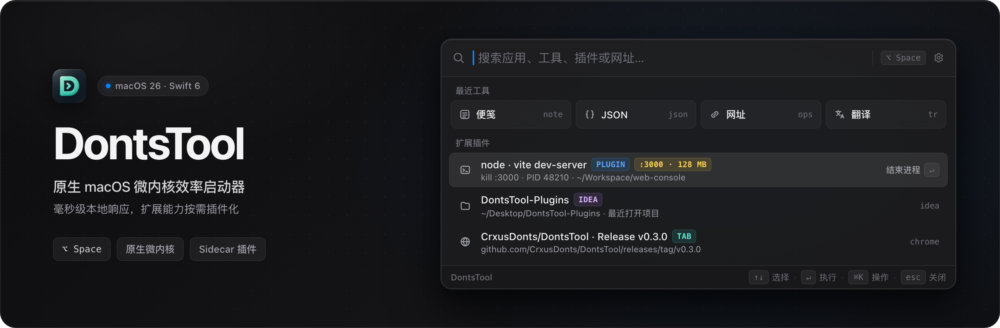
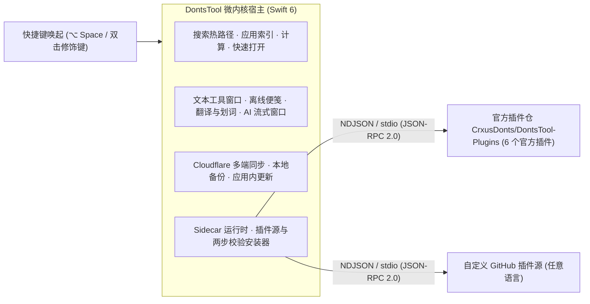

<div align="center">
  <picture>
    <source media="(prefers-color-scheme: dark)" srcset="docs/assets/banner-dark.png" />
    <source media="(prefers-color-scheme: light)" srcset="docs/assets/banner-light.png" />
    
  </picture>

  <h1>DontsTool</h1>

  <p>写给自己日常用的原生 macOS 效率小玩具 · 微内核启动器 + 进程外插件</p>

  <p>
    <a href="https://github.com/CrxusDonts/DontsTool/releases/latest"></a>
    
    
    <a href="https://github.com/CrxusDonts/DontsTool-Plugins"></a>
  </p>

  <p>
    <a href="#快速安装">快速安装</a> ·
    <a href="#架构一览">架构一览</a> ·
    <a href="#内置能力">内置能力</a> ·
    <a href="#插件生态">插件生态</a> ·
    <a href="#键盘交互">键盘交互</a> ·
    <a href="#隐私安全">隐私安全</a> ·
    <a href="#开发文档">开发文档</a>
  </p>
</div>

> [!NOTE]
> 这是一个写给自己日常用的 macOS 小玩具，顺手开源出来。里面的功能都是按自己平时写代码、查东西的习惯慢慢拼起来的，不追求大而全，也没打算做成商业产品；如果刚好合你胃口，欢迎直接拿去用，或者按自己习惯改。

<a id="安装"></a>

## 快速安装

在终端执行一行命令即可安装最新稳定版，无需登录 GitHub 或使用 `sudo`：

```bash
curl -fsSL https://raw.githubusercontent.com/CrxusDonts/DontsTool/main/install.sh | /bin/bash
```

> [!TIP]
> 应用常驻菜单栏、不显示 Dock 图标。打开后按 <kbd>⌥</kbd> + <kbd>Space</kbd> 呼出启动器，前往 **设置 → 插件** 点击「安装全部推荐插件」即可装齐官方插件；已安装旧版的用户可直接在菜单栏点击「检查更新」升级。

<details>
<summary>手动下载安装（Universal ZIP）与脚本参数</summary>

1. 前往 [GitHub Releases](https://github.com/CrxusDonts/DontsTool/releases/latest) 下载 `DontsTool-版本号-macos-universal.zip`。
2. 解压后将 `DontsTool.app` 拖入「应用程序」目录（更新前先保存草稿并正常退出旧版）。
3. 脚本支持 `--dir "$HOME/Applications"` 和 `--version v0.4.6` 等选项，完整校验与签名说明见 [安装与完整性校验](docs/installation.md)。

</details>

## 架构一览

DontsTool 将启动器热路径、原生工作窗口、离线便笺与云同步留在 Swift 微内核中，外部集成以独立子进程插件运行，按需安装并热重载：



## 内置能力

<table>
  <tr>
    <td width="50%" valign="top">
      <h3>搜索与跳转</h3>
      <ul>
        <li><strong>应用启动</strong>：支持英文、中文、全拼与首字母搜索，FSEvents 实时监听目录变更，按最近打开、频率或名称排序。</li>
        <li><strong>快速打开</strong>：直接识别 <code>http(s)://</code>、<code>www.</code>、<code>~/</code>、绝对路径与 <code>file://</code>，支持在默认终端打开。</li>
        <li><strong>网址快捷入口</strong>：支持多环境（如 <code>prod</code> / <code>test</code>）与子页面层级跳转，提供表单编辑和 JSON 批量导入导出。</li>
        <li><strong>网页搜索</strong>：自定义搜索引擎快捷词；无本地匹配时自动回退到默认引擎。</li>
      </ul>
    </td>
    <td width="50%" valign="top">
      <h3>研发工作台</h3>
      <ul>
        <li><strong>独立文本工具窗口</strong>：输入 <code>json</code>、<code>b64</code>、<code>url</code>、<code>ts</code>、<code>uuid</code>、<code>md5</code>、<code>sha256</code> 新建具名窗口，支持多开、重命名与置顶。</li>
        <li><strong>JSON 深度编辑</strong>：支持格式化、压缩、转义、代码折叠与双栏 Diff 对比。</li>
        <li><strong>即时计算与换算</strong>：直接计算算式（如 <code>(128 + 64) * 3</code>）与常用单位换算（如 <code>10 km to mi</code>），回车复制结果。</li>
        <li><strong>粘贴内容模式</strong>：在空搜索框粘贴文本、链接或 JSON，自动匹配适用工具并保留原文带入。</li>
      </ul>
    </td>
  </tr>
  <tr>
    <td width="50%" valign="top">
      <h3>便笺、翻译与 AI</h3>
      <ul>
        <li><strong>本地离线便笺</strong>：输入 <code>note</code> 或 <code>便笺</code> 检索与新建，内置离线 Tiptap 所见即所得与 Markdown 编辑，支持粘贴图片、置顶与回收站。</li>
        <li><strong>AI 流式对话窗口</strong>：在 <strong>设置 → 模型服务</strong> 可配置多套大模型（支持 OpenAI Responses、Gemini 原生与 OpenAI Chat Completions），并按消费方（内置翻译或声明 AI 能力的插件）分别绑定模型；配合官方插件 <code>AI 快问</code>（<code>ai</code> / <code>ask</code> / <code>问</code>）或粘贴内容模式直接唤起原生流式对话窗口，支持代码块渲染、多轮追问、多开与置顶。</li>
        <li><strong>翻译与长按划词</strong>：输入 <code>tr</code> 打开翻译窗口，或在 <strong>设置 → 翻译</strong> 开启全局鼠标右键长按划词，自动使用「模型服务」中绑定的翻译模型，密钥仅存本机钥匙串。</li>
      </ul>
    </td>
    <td width="50%" valign="top">
      <h3>同步与更新</h3>
      <ul>
        <li><strong>Cloudflare 多端同步</strong>：可选部署自建 Worker（Durable Object + R2）跨 Mac 实时增量同步设置、网址、搜索引擎与便笺附件。</li>
        <li><strong>本地完整备份</strong>：一键导出带 SHA-256 校验的 <code>.zip</code> 快照，恢复前自动留存当前状态备份。</li>
        <li><strong>应用内更新</strong>：在菜单栏点击「检查更新」即可获取并安装新版本。</li>
        <li><strong>内置使用指南</strong>：输入 <code>help</code> 或 <code>?</code> 速查全部触发词、示例与当前快捷键。</li>
      </ul>
    </td>
  </tr>
</table>

## 插件生态

官方插件仓库 [CrxusDonts/DontsTool-Plugins](https://github.com/CrxusDonts/DontsTool-Plugins) 已内置在 **设置 → 插件**，包含 6 个官方 Swift 插件和 1 个脚本示例插件：

| 插件 | ID | 触发关键词 | 说明 |
| --- | --- | --- | --- |
| AI 快问 | `com.donts.quick-ai` | `ai` `ask` `问` | 复用宿主大模型配置，在原生流式窗口中即时问答、解释代码与排查报错 |
| 结束进程 | `com.donts.kill-process` | `kill` `kp` `进程` | 按名称、PID、命令或 `:端口` 查找并结束进程，支持优雅退出与强杀 |
| IDEA 项目 | `com.donts.idea-projects` | `idea` | 列出 IntelliJ IDEA 最近项目，支持模糊筛选与直接输入本地目录路径打开 |
| 文件搜索 | `com.donts.file-search` | `file` | 在用户主目录内按需调用 Spotlight 检索本地文件，支持定位与复制路径 |
| Google Chrome | `com.donts.chrome` | `chrome` `ch` `tab` `tabs` `bm` `书签` `标签页` | 搜索、切换与关闭已打开标签页，并检索多 Profile 书签与浏览历史 |
| 终端与访达 | `com.donts.terminal-finder` | `tf` `ft` `term` `终端` | 在访达与 Ghostty、Warp、iTerm2、系统终端之间双向跳转当前目录 |
| Hello Sidecar 示例 | `com.example.hello-sidecar` | `hello` | 无依赖 Python 示例，演示多语言 NDJSON 协议与回调动作 |

- **进程隔离**：插件以独立子进程（`oneshot` / `daemon`）通过 NDJSON over stdio 通信，支持超时截断、取消与热重载，不拖慢启动器本地热路径。
- **零后端 GitHub 源**：除官方源外，支持在设置中输入 `owner/repo`、GitHub 链接或 HTTPS `catalog.json` 添加自定义单插件仓与多插件合集仓。
- **两步安全安装**：安装与更新前先校验宿主版本和 SHA-256，弹窗展示全部申请权限及跨源同名冲突提示，用户确认后原子落盘并立即生效。

安装细节、协议规范与开发示例见 [插件使用与开发指南](docs/plugins.md)。

## 键盘交互

| 快捷键 | 作用 |
| --- | --- |
| <kbd>⌥</kbd> <kbd>Space</kbd> | 呼出或收起启动器（可在设置中修改为其他组合键或双击修饰键） |
| <kbd>↵</kbd> | 执行当前选中结果的主操作 |
| <kbd>⌘</kbd> <kbd>↵</kbd> | 执行次操作（访达定位文件、强制结束进程、新建独立便笺等） |
| <kbd>⌘</kbd> <kbd>K</kbd> | 打开更多操作面板（在终端打开、无痕打开、复制链接或路径） |
| <kbd>⌘</kbd> <kbd>⇧</kbd> <kbd>C</kbd> | 复制选中文件或路径条目的完整路径 |
| <kbd>⌘</kbd> <kbd>V</kbd> | 在空搜索框粘贴文本、网址或 JSON，进入内容模式匹配工具 |
| <kbd>Esc</kbd> | 依次关闭操作面板、清空粘贴内容或隐藏面板并恢复原应用焦点 |

## 隐私安全

> [!NOTE]
> DontsTool 无任何遥测或统计上报，不在后台监听剪贴板；大模型与翻译 API 密钥、Cloudflare 同步密钥与插件私密配置仅保存在本机 macOS 登录钥匙串中，不写入配置文件、日志或本地备份包，也不会透传给外部插件进程。

- **网络最小化**：仅在主动执行网页搜索、AI 对话、翻译、检查应用更新、拉取/安装插件或开启自建云同步时联网。
- **权限按需申请**：组合键与双击修饰键不需要辅助功能权限；仅右键长按划词需要「辅助功能」，Chrome / 终端访达插件需要「自动化」，文件搜索插件在受保护目录可按需授权「完全磁盘访问」。
- **插件权限门控**：宿主执行插件动作前强制校验 `manifest.json` 权限声明，未声明的动作直接拦截。

## 开发文档

工程由 `project.yml` 通过 XcodeGen 生成（`DontsTool.xcodeproj` 不入库），本地构建需要 macOS 26、Xcode 26+ 与 XcodeGen：

```bash
brew install xcodegen
make build
open build/Build/Products/Debug/DontsTool.app
```

<details>
<summary>查看全部测试与验证命令</summary>

```bash
make test            # Core 核心单元测试（含插件运行时、源管理与安装器）
make test-bridge     # 原生窗口、系统事件与 WebKit 桥接测试
make test-editor     # 离线便笺编辑器测试并重新生成资源
make test-updater    # 解析包依赖并验证更新源脚本
make test-installer  # 安装脚本完整性、回滚与并发锁测试
```

</details>

| 使用指南 | 架构与工程 |
| --- | --- |
| [插件使用与开发指南](docs/plugins.md) | [架构总览](docs/architecture.md) |
| [安装与完整性校验](docs/installation.md) | [ADR 架构决策记录](docs/adr/) |
| [网址快捷入口配置说明](docs/website-shortcuts.md) | [版本发布与打包流程](docs/releasing.md) |
| [本地便笺使用指南](docs/local-notes.md) | [仓库协作指南](AGENTS.md) |
| [划词翻译与配置说明](docs/selection-translation.md) | |
| [应用动作与外迁说明](docs/application-actions.md) | |
