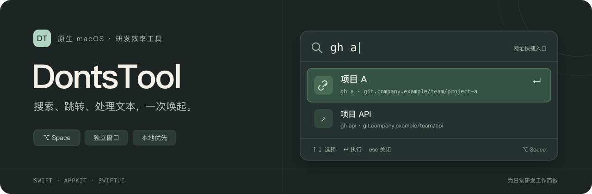

<p align="center">
  
</p>

# DontsTool

一个原生 macOS 研发效率启动器。用快捷键唤起，搜索应用和文件，打开常用网址，或进入独立工具窗口处理 JSON、Base64、时间戳等内容。

[下载 Release](https://github.com/CrxusDonts/DontsTool/releases/latest) · [安装](#安装) · [网址配置](docs/website-shortcuts.md) · [开发与发布](#开发与发布)

## 能做什么

| 功能 | 使用方式 |
| --- | --- |
| 应用与文件 | 应用直接输入名称；文件输入 `file 文件名` 按需查询 Spotlight，回车打开；应用目录变化后自动更新 |
| 应用排序与检索 | 空搜索默认最近使用，可切换使用频率或名称；支持中文拼音、首字母、英文简称及应用文件名 |
| 内容动作 | 在空搜索框主动粘贴 JSON、链接或文本，再筛选适用操作；原文保留到明确执行时带入工具 |
| Gemini 提问 | `gm 问题` 回车后在已安装的 Gemini 中新建对话并发送；保留已有草稿 |
| IDEA 项目 | `idea` 列最近项目，`idea 名称` 筛选，回车交给 IDEA 打开 |
| 计算器与单位换算 | 直接输入 `1+1`、`sqrt(16)` 或 `10 km to mi`，回车复制结果 |
| 快速打开 | 直接输入 `https://…`、`www.…`、`~/…` 或已存在的绝对路径 |
| 操作面板 | 任意结果按 `⌘K`，可打开、在访达中显示、退出应用、复制路径或链接 |
| 网址快捷入口 | 自定义 `前缀 系统 子页面 环境`，如 `ops avatar management prod`；支持单网址、多环境、页面路径、别名和 JSON 导入导出 |
| JSON | 格式化、压缩、转义、去转义和结构对比，保留大整数精度 |
| 文本小工具 | Base64、URL 编解码，时间戳转换，批量 UUID，MD5 / SHA1 / SHA256 |
| 网页搜索 | `g`、`bing`、`bd`、`ddg`、`gh`；自定义 `gh` 分组后由网址快捷入口接管 |
| 翻译 | `tr` 打开翻译窗口；可选开启全局右键长按划词翻译，使用自己配置的 Responses 兼容 API 服务，密钥保存在钥匙串 |
| DontsKb 插件 | `kb` 搜索和编辑文章，`collect` 快速收集，`inbox` 打开收集箱 |

从启动器打开 JSON、Base64 等工具会新建独立窗口。同类工具可以同时处理多份内容，标题可命名，窗口可置顶。JSON、Base64 和 URL 使用单编辑区原地操作，支持撤销；JSON 对比使用双栏。

工具文本草稿仅保留本次运行，退出应用后清除。网址配置和设置会保存在本机；知识库的保存与草稿由 DontsKb 管理。

## 安装

需要 **macOS 26 或更新版本**。发布包是 **Universal**，同时包含 Apple Silicon（arm64）和 Intel（x86_64）架构。

### 下载与更新

1. 登录有仓库访问权限的 GitHub 账号，前往 [Releases](https://github.com/CrxusDonts/DontsTool/releases/latest)，下载 `DontsTool-版本号-macos-universal.zip`。仓库和 Release 均为私有，未登录时可能显示 404。
2. 一并下载 `SHA256SUMS` 和 `manifest.json`。将三个文件放在同一目录，在终端进入该目录后校验：

   ```bash
   shasum -a 256 -c SHA256SUMS
   ```

3. 解压 ZIP，将 `DontsTool.app` 拖入「应用程序」目录。更新前先保存或复制需要保留的工具草稿，并从菜单栏正常退出旧版，再替换应用。
4. 打开「应用程序 → DontsTool」。它常驻菜单栏，不显示 Dock 图标；默认按 **⌥ Space** 呼出启动器。

也可以用已登录的 GitHub CLI 下载：

```bash
gh release download --repo CrxusDonts/DontsTool \
  --pattern 'DontsTool-*-macos-universal.zip' \
  --pattern manifest.json --pattern SHA256SUMS \
  --dir "$HOME/Downloads/DontsTool" --clobber

cd "$HOME/Downloads/DontsTool"
shasum -a 256 -c SHA256SUMS
```

### 首次打开：本地签名

当前发布使用 **ad-hoc 本地签名**，没有 Developer ID 证书，也**未经 Apple 公证**。签名完整性检查通过，不代表 Apple 已验证开发者身份或完成安全审查。

如果 macOS 提示无法验证开发者，先尝试打开一次，再进入「系统设置 → 隐私与安全性」，找到 DontsTool 对应的提示并选择「仍要打开」。操作说明见 [Apple 官方文档](https://support.apple.com/102445)。

如果下载隔离标记仍阻止打开，仅在确认包来自本仓库、SHA256 校验通过后，可针对这个应用移除隔离标记：

```bash
codesign --verify --deep --strict "/Applications/DontsTool.app"
xattr -dr com.apple.quarantine "/Applications/DontsTool.app"
open "/Applications/DontsTool.app"
```

无需关闭整个系统的 Gatekeeper，也无需重新签名发布包。

## 开始使用

在启动器底部点击设置按钮，或按 **⌘ ,** 进入设置。

- **最近使用**：空搜索时，应用分组的「排序」可切换最近使用、使用频率或名称。正常切换到应用也会更新本机最近使用记录，不限于经启动器打开；使用频率统计从启动器执行打开的次数。记录仅保存在本机，新启用后逐步积累。
- **定位文件**：选中或悬停文件结果，点击右侧文件夹按钮，在访达打开所在目录并选中文件。也可按 `⌘Enter`，或从 `⌘K` 操作菜单选择「在访达中显示」；普通回车仍打开文件。直接输入完整路径的结果同样支持。
- **按需搜索文件**：普通输入不查询文件；输入 `file 报告` 才按文件名查询 Spotlight，单独输入 `file` 显示使用提示。可在「设置 → 搜索」关闭此功能；完整路径仍可直接打开。
- **主动粘贴**：在空搜索框按 `⌘V` 或「粘贴并匹配样式」，内容会成为可移除的胶囊；搜索框用于筛选动作。JSON 推荐 JSON 工具，网页链接提供打开和 URL 编解码，文本提供 Base64 与翻译入口。回车只打开对应工具并带入原文，不自动转换或发送翻译请求。Esc 先关闭动作面板，再清空筛选词、移除内容，最后收起启动器。
- **界面与动效**：启动器采用石墨／暖灰与薄荷绿配色，遵循系统外观。窗口短距离淡入淡出、选中背景连续移动，系统开启「减少动态效果」或「减少透明度」时相应降级。本地可交互设计稿见 [Fluid Launcher](design/fluid-launcher/index.html)。

- **快捷键**：默认 `⌥ Space`；可改为其他组合键，或双击 `⌥`、`⌘`、`⌃`、`⇧` 呼出。双击修饰键不依赖输入监控或辅助功能授权。
- **Gemini 提问**：输入 `gm 问题` 或 `gemini 问题`，回车后在已安装的 Gemini Mac 应用中新建并发送。自动输入需要辅助功能授权，可在「设置 → 内置工具 → Gemini 自动提问」授权；未授权时可选「仅打开 Gemini」。已有未发送草稿会保留并停止操作，发送前按 Esc 或切换应用可取消。
- **IDEA 项目**：输入 `idea` 按最近打开时间列出当前版本项目，`idea kb` 按名称或路径筛选，也可输入 `idea 完整项目目录`。回车使用已安装的 IntelliJ IDEA 打开，`⌘K` 可在访达中显示或复制路径；无需辅助功能或 IDE 插件。详见 [应用动作](docs/application-actions.md)。
- **计算器**：直接输入算式或 `10 km to mi` 这类单位换算，结果会出现在工具分组；回车复制。支持 `+ - * / ^`、取模 `%`、括号、`sqrt`、`abs`、`round`、`floor`、`ceil`、`ln`、`log`、`sin`、`cos`、`tan` 和长度、质量、温度、数据、时间、速度换算。`calc` 或 `=` 可强制按算式处理。
- **快速打开**：直接输入网址（含 `www.` 开头）或已存在的 `~/`、绝对路径；`open` 关键字可强制进入该模式。网址只有在执行打开动作时才交给默认浏览器。
- **操作面板**：选中结果按 `⌘K` 打开全部操作，`↑`、`↓` 选择，`↵` 执行，`esc` 返回。应用支持退出应用和复制路径；文件支持在访达中显示和复制路径；网页结果支持复制链接。
- **工具窗口**：输入 `json`、`base64`、`uuid` 等，回车新建窗口。操作文本、命名和置顶都在工具窗口内完成。
- **网址快捷入口**：在设置中添加分组和网址，或导入 JSON。输入 `gh` 列出分组内项目，`gh a` 匹配项目，回车才打开默认浏览器；多环境系统可用 `ops 订单 test` / `ops 订单 prod` 筛选，`ops 订单` 列出全部环境及实际地址；系统内可添加子页面，`ops avatar management prod` 直达生产管理页；分组内没有匹配时不会回退到公共搜索。
- **知识库**：设置兼容 `/tool` 插件页面的 DontsKb 服务地址，在知识库窗口内登录。普通打开文章沿用当前窗口，只有明确选择「新窗口打开」才另开。
- **翻译**：使用你在「设置 → 翻译」填写的大模型服务，需要接口地址、模型和 API 密钥（Responses 兼容）。未配置时提示补全设置，不自动切换到系统翻译。

### 右键长按划词翻译

在「设置 → 翻译」打开「右键长按翻译」，点击「授权辅助功能」，在 macOS 系统设置中允许 DontsTool。返回应用后会重新检查授权，也可点击「重新检查」。此功能默认关闭，不会在启动时请求权限；原有启动器快捷键不需要该授权。

在其他应用中先选中文字，再按住鼠标右键或用双指**按下触控板并保持约 2 秒**，鼠标旁会显示原文和译文卡片。仅把手指放在触控板上、双指轻点或单指 Force Click 均不是该触发方式。卡片支持复制译文、重试、固定及打开原文编辑；Esc 关闭，未固定时点击外部或切换应用也会关闭。一次只保留一张卡片。

短按在松开时还原原有右键，移动超过容差则恢复右键拖动。满两秒后才读取选区；读取期间显示等待状态，失败或超时显示具体原因和编辑入口，不发送翻译请求。关闭卡片或编辑原文会取消尚未完成的取词。仅处理鼠标所在的前台普通窗口；后台窗口、菜单和带修饰键的右键保持原样。

取词依赖目标应用的辅助功能支持，部分 IDE、终端、自绘文本及图片中的文字可能无法读取。不会自动按 Cmd-C、不读取剪贴板，也不做截图/OCR；这些场景可手动复制到翻译窗口。单次选区上限为 8000 个 UTF-16 单元，超过时显示提示。详细实现与验收边界见 [划词翻译说明](docs/selection-translation.md)。

### 网址配置示例

下面的地址为虚构示例，请替换成自己的站点：

```json
{
  "version": 3,
  "groups": [
    {
      "keyword": "ops",
      "name": "公司系统",
      "items": [
        {
          "key": "avatar",
          "name": "Avatar",
          "aliases": [
            "头像系统"
          ],
          "environments": [
            {
              "key": "test",
              "name": "测试",
              "url": "https://avatar.test.company.example"
            },
            {
              "key": "prod",
              "name": "生产",
              "url": "https://avatar.company.example"
            }
          ],
          "pages": [
            {
              "key": "management",
              "name": "管理页",
              "path": "/admin/management",
              "aliases": [
                "管理",
                "managment"
              ]
            },
            {
              "key": "metrics",
              "name": "监控",
              "path": "/metrics",
              "urls": {
                "prod": "https://metrics.company.example/avatar"
              }
            }
          ]
        }
      ]
    }
  ]
}
```

手动编辑与 JSON 配置共用同一份数据。导入后先检查，点击保存才替换；错误配置不会部分覆盖。完整字段、匹配规则和限制见 [网址快捷入口说明](docs/website-shortcuts.md) 与 [示例文件](docs/examples/website-shortcuts.json)。

## 数据与网络

- 本地工具处理和网址匹配在本机执行，无遥测，不监听剪贴板。算式和单位换算完全在本地计算，不联网。
- 仅在工具窗口或操作面板中显式执行复制/粘贴时访问剪贴板；操作面板的复制动作也只写入用户明确选择的结果。启用双击修饰键后，只订阅修饰键变化并查询普通按键计数/时间，不记录普通按键内容。
- 开启划词翻译后，通过鼠标事件识别长按，通过辅助功能读取触发时的选区；浮动卡片显示期间监听 Esc 以关闭。仅在长按成功或主动重试时把选中文字发送到配置的翻译服务，不记录选中文字或普通按键内容。
- 网址仅在执行打开动作时交给默认浏览器；网页搜索、翻译和知识库连接会访问对应服务。
- 翻译密钥保存在 macOS 钥匙串。知识库登录由同源 Web 页面管理，DontsTool 不通过桥接读取登录凭据。

## 开发与发布

运行时无第三方依赖，使用 Swift 6、AppKit、SwiftUI 与系统 WebKit。工程由 [project.yml](project.yml) 通过 XcodeGen 生成，`DontsTool.xcodeproj` 不入库。

准备完整 Xcode（含 macOS 26 SDK）、命令行工具及 XcodeGen：

```bash
brew install xcodegen
xcodebuild -version
xcodegen --version

make test          # Core 单元测试
make test-bridge   # 真实 WKWebView / 原生窗口集成测试
make app           # Debug 构建
make run           # 退出本机同名进程，再运行 Debug 版；先保留需要的草稿
make release       # 构建、ad-hoc 签名、校验并打包 Universal 版
```

本地已使用 Xcode 27.1 / XcodeGen 2.46 构建；CI 使用 GitHub `macos-26` 镜像自带的 Xcode，并在日志记录实际版本。[Runner 工具列表](https://github.com/actions/runner-images/blob/main/images/macos/macos-26-arm64-Readme.md) 可用于核对环境。

发布产物位于 `dist/`：

```text
DontsTool-0.2.0-macos-universal.zip
manifest.json
SHA256SUMS
```

`manifest.json` 记录版本、构建号、源码提交、最低系统版本、架构、签名方式和 ZIP 的 SHA256。构建与发布脚本不会修改已安装的应用。

### GitHub Actions

- [CI](.github/workflows/ci.yml)：推送 `main` 或创建 PR 时，运行 Core 与 WebKit 集成测试。
- [Release](.github/workflows/release.yml)：推送 `vMAJOR.MINOR.PATCH` 标签时，先将标签解析为固定提交、验证同一份源码，再构建 Universal 版并验证签名、压缩包和校验文件。上传至草稿 Release 后下载回验，逐字节一致才正式发布。
- 使用 GitHub 的临时 `GITHUB_TOKEN` 上传产物，不需要 Apple 证书、私钥或公证凭据。已发布版本不会被覆盖；同一源码的草稿可在失败后重跑。

发布新版本时，先修改 [Resources/Info.plist](Resources/Info.plist) 的 `CFBundleShortVersionString`，提交到 `main`，再推送一致的标签：

```bash
# 示例：将源码版本更新为 0.2.1 并提交后
git push origin main
git tag -a v0.2.1 -m 'DontsTool v0.2.1'
git push origin v0.2.1
```

也可在 Release 工作流的手动运行入口填写**已存在的标签**重试。版本不匹配、测试失败或校验失败都会阻止发布。流程细节见 [发布说明](docs/releasing.md)。

## 项目结构与文档

```text
Sources/DontsTool/          应用生命周期、原生窗口与界面
Sources/DontsToolCore/      搜索、配置、工具逻辑与服务协议
Tests/                     Core 测试与 WebKit 集成测试
Resources/                 应用元数据
scripts/                   构建、校验与发布脚本
.github/workflows/         CI 和 Release
design/                   设计参考与 HTML 导出
docs/                     使用说明、架构决策和验证记录
```

- [架构总览](docs/architecture.md) · [架构决策 ADR](docs/adr/)
- [工具窗口设计](docs/superpowers/specs/2026-10-18-tool-workspaces-design.md) · [实现审查](docs/reviews/2026-10-18-tool-workspaces-review.md)
- [知识库插件协议](docs/superpowers/specs/2026-10-18-knowledge-plugin-design.md) · [窗口交互审查](docs/reviews/2026-10-18-knowledge-window-refinement.md)
- [网址快捷入口](docs/website-shortcuts.md) · [实现审查](docs/reviews/2026-10-18-website-shortcuts.md)
- [常用操作与即时工具](docs/reviews/2026-10-20-launcher-actions.md)
- [工具工作区 HTML 参考](design/tool-workspaces-v2/index.html) · [网址配置 HTML 参考](design/website-shortcuts/index.html)

设计稿与历史计划用于记录决策；当前能力以源码、测试和本 README 为准。仓库保持私有。
