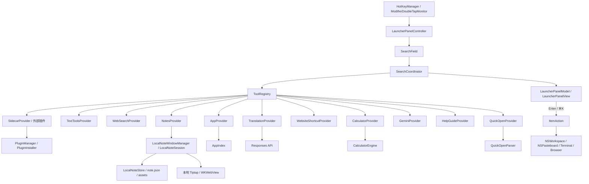

# DontsTool 架构总览

> 状态：当前实现（微内核宿主 + 外部 Sidecar 插件与 GitHub 插件源）。最后更新：2026-11-21。
> 详细行为与验收标准见 [V1 详细设计](superpowers/specs/2026-10-18-dontstool-design.md) 与 [ADR 0008](adr/0008-microkernel-sidecar-plugins.md)。

## 1. 项目定位

DontsTool 是一个原生 macOS 菜单栏效率启动器。按下全局热键呼出浮动面板，输入即搜：

- 微内核内置：启动应用、即时计算与单位换算、网址/路径快速打开、自定义网址快捷入口、网页搜索、文本工具独立工作窗口（JSON、Base64、URL、时间戳、UUID、Hash）、翻译与全局右键长按划词、本地离线便笺、Gemini 提问、内置使用指南，以及可选的自建 Cloudflare 多端同步与本地备份。
- 外部 Sidecar 插件：通过 `PluginManager` 与 `PluginInstaller` 按需从官方仓库 `CrxusDonts/DontsTool-Plugins` 或自定义 GitHub 仓库安装扩展（如文件搜索、IDEA 项目、Google Chrome、终端与访达、结束进程）。

设计目标：

1. **原生响应**：启动器和工具使用原生窗口，本地便笺按需使用离线 WKWebView，不引入 Electron/Tauri；热键到面板可见目标 < 100ms。
2. **键盘优先**：高频操作全部可以用键盘完成。
3. **微内核易扩展**：热路径与通用宿主能力留在微内核，外部扩展以进程外 Sidecar 插件实现，不阻塞主程序响应。
4. **可维护**：模块边界清晰，决策有 ADR，行为有验收标准。
5. **隐私优先**：无遥测；不监听剪贴板；网络仅由用户主动执行网页搜索、翻译、检查应用更新、拉取/安装插件或开启自建云同步时触发。

非目标：跨平台、中心化托管账号与封闭插件市场、App Store 发布与沙盒。

## 2. 技术栈

| 项目 | 选择 |
| --- | --- |
| 语言 | Swift 6 |
| UI | SwiftUI 承载全部界面内容（面板、设置、Toast），AppKit 只做薄壳（NSPanel、热键、搜索框键盘/IME、菜单栏）；设计令牌层 `UI/DesignSystem` |
| 全局热键 | Carbon `RegisterEventHotKey` |
| 应用启动 | `NSWorkspace` |
| 插件运行时 | 进程外 Sidecar（NDJSON over stdio，JSON-RPC 2.0），官方外迁插件托管于 `CrxusDonts/DontsTool-Plugins` |
| 翻译 | 用户配置的 OpenAI Responses 兼容 HTTP API（`URLSession`）；密钥存钥匙串 |
| 开机启动 | `SMAppService` |
| Hash | `CryptoKit` |
| 持久化 | `UserDefaults`（设置与插件源）、钥匙串（翻译 API 密钥、云同步密钥与插件私密配置）、应用支持目录内的版本化 JSON、便笺附件与已安装插件 |
| 构建 | XcodeGen 生成工程 + `xcodebuild`，Makefile 封装；Xcode 26+ / Swift 6（CI 运行在 macOS 26 / Xcode 26.6） |
| 第三方依赖 | Sparkle 2.10.1（应用内更新）；本地便笺离线打包 Tiptap 3.34.0 / ProseMirror；构建依赖 XcodeGen、编辑器生成依赖 Node / esbuild |
| 分发 | GitHub Release（Universal），Developer ID（`Q2K3CAKGG2`）签名与 Apple 公证，非沙盒 |

## 3. 进程与运行形态

- 主程序为菜单栏常驻 App，已安装的外部插件按 `oneshot` 或 `daemon` 模式以独立子进程运行。
- `LSUIElement = true`，激活策略 `.accessory`，不显示 Dock 图标。
- 启动时注册全局热键，在后台构建应用索引并扫描本地已安装插件；面板随时可呼出。
- 空闲时没有轮询和定时任务（`daemon` 插件空闲超时后自动回收），只等待热键与用户输入。
- 退出入口在菜单栏菜单中，退出前同步终止活跃插件子进程。
- 非沙盒运行，方便系统集成、应用控制与外部插件协作；不以 App Store 发布为目标。

## 4. 模块划分



| 模块 | 职责 | 关键类型 |
| --- | --- | --- |
| AppShell | 应用生命周期、菜单栏、浮动面板、热键、焦点管理、独立工具与便笺窗口 | `AppDelegate`、`HotKeyManager`、`ModifierDoubleTapMonitor`、`LauncherPanelController`、`MenuBarController` |
| Core | 查询解析、路由、聚合、排序、注册、设置与使用统计、即时计算与路径识别 | `SearchCoordinator`、`QueryParser`、`ToolRegistry`、`FuzzyMatcher`、`UsageStore`、`SettingsStore`、`CalculatorEngine`、`QuickOpenParser` |
| Index | 本机应用索引与目录变更监听 | `AppIndex`、`AppScanner`、`AppDirectoryMonitor` |
| Terminal | 首选终端识别与在终端中打开目录（供快速打开及外部插件复用） | `SystemTerminalFinderService`、`TerminalAppCatalog`、`TerminalAppDescriptor` |
| Providers | 微内核内置结果提供者，统一实现 `ToolProvider` | `AppProvider`、`TextToolsProvider`、`WebSearchProvider`、`TranslationProvider`、`CalculatorProvider`、`QuickOpenProvider`、`WebsiteShortcutProvider`、`NotesProvider`、`GeminiProvider`、`HelpGuideProvider` |
| Plugins | 微内核进程外 Sidecar 插件运行时、GitHub 插件源管理与校验安装更新器 | `PluginManager`、`SidecarProvider`、`SidecarTransport`、`PluginHostContext`、`PluginManifest`、`PluginCatalog`、`PluginSourceStore`、`PluginInstaller`、`PluginSettingsStore` |
| Tools | 独立工具窗口与文本处理 | `ToolDefinition`、`ToolSession`、`ToolWindowManager`、`JSONDocument` |
| Notes | 本地便笺、离线富文本、自动保存与独立附件 | `LocalNoteStore`、`LocalNoteSession`、`LocalNoteEditorBridge`、`LocalNoteWindowManager` |
| Sync | Cloudflare 多端增量同步与本地快照备份 | `CloudSyncCoordinator`、`CloudSyncClient`、`SyncStateStore`、`BackupArchiveService` |
| Services | 外部 API、钥匙串、登录项、系统动作 | `RemoteTranslationService`、`SecretStore`、`LoginItemManager`、`SystemAppLauncher` |
| Settings | 设置界面、网址配置、插件商店与源管理、热键录制 | `SettingsWindowController`、`SettingsRootView`、`PluginsSettingsTabView` |

## 5. 关键流程

### 5.1 呼出与隐藏

1. 用户按下全局热键，`HotKeyManager` 收到 Carbon 事件。
2. 记录当前前台应用，供隐藏时恢复焦点。
3. 面板定位到鼠标所在屏幕顶部偏中位置。
4. `makeKeyAndOrderFront`，搜索框成为第一响应者。
5. 再次按热键、按 `Esc`、面板失焦、或执行完动作后隐藏。
6. 隐藏后如抢走了前台焦点，则激活之前记录的应用。

窗口进入与退出由 `PanelTransitionDriver` 管理位置和透明度，转场期间使用窗口所属显示器的 `CADisplayLink` 驱动，完成或取消即释放。支持中途反向与取消，避免旧的关闭回调隐藏重新打开的面板。SwiftUI 用行锚点定位一块连续滑动的选中背景，并管理操作浮层；动效跟随系统「减少动态效果」，背景跟随「减少透明度」。

### 5.2 搜索

1. 搜索框已确认文本变化，`QueryParser` 判断是全局模式还是关键词模式。AppKit marked text 组合期间暂停搜索并取消旧查询，清除旧的可执行结果；候选词方向键、回车和 Esc 归输入法处理。`LauncherFieldEditor` 同时覆盖 unmarkText 与 insertText 的提交路径，在最外层编辑完成后恢复查询，避免提交中间态。
2. **快速阶段**：内置应用搜索、文本工具提示、网页搜索、网址快捷入口、本地便笺、算式/单位换算、网址/路径快速打开在每次输入时立即参与，结果即时渲染。
3. **慢速阶段**：需要子进程或较重查询的 `ToolProvider`（如运行在 `.slow` 阶段的外部 Sidecar 插件，包括官方外迁的 `com.donts.file-search`）在已确认输入停止 120ms 后触发，单次请求超时上限 2 秒，正常完成立即返回。外部插件默认 `supportsGlobalSearch = false`，仅响应显式关键词或声明式 `globalAliases` 发现入口，普通全局查询不会唤醒子进程。
4. 新的输入或输入法组词开始时取消上一轮慢速请求，向 `daemon` 插件发送 `cancel` 通知或终止 `oneshot` 进程；过期结果直接丢弃，取消不误报失败。
5. 结果按分组和分数排序、去重后展示。算式和快速打开的分数高于普通工具提示；存在本地结果时不再展示网页回退。

应用的 `AppSearchDocument` 缓存中文拼音、首字母和文件名别名，索引变化时更新，避免逐次输入做音译。扫描器每次直接读取原始 plist 和本地化 strings／loctable，避免同路径安装或更新后读到缓存名称。空查询默认只展示从启动器成功打开过的应用，按最近打开时间倒序，最多四个，不用未打开的应用填充。只有应用结果的打开动作成功后才写入时间和次数，不再订阅系统应用激活通知。频率和名称排序仍可浏览其他索引应用；主动输入搜索不受历史范围限制。旧应用历史一次性移除零次数系统激活项，保留真实打开次数并重置不可信时间；未知时间的旧项目不参与最近列表，下次从启动器打开后重新进入。网址和文件历史不变。排序偏好和使用记录保存在本机。

空输入框的显式粘贴进入独立的内容操作流程：`ContentDescriptor` 识别类型，`ContentActionProvider` 生成工具入口，`LauncherPanelModel` 取消全局查询并保留原文。筛选只作用于动作，源文本不传给全局 Provider；移除内容或关闭面板时清理。打开工具仅预填原文，转换和网络请求由用户在工具窗口内执行。

### 5.3 执行

1. 用户按 `Enter` 或点击结果项，执行该项的主操作。文件行在选中或悬停时显示独立文件夹按钮，按该行索引执行第二动作，在访达中选中文件；主按钮与文件夹按钮并列，避免点击定位时同时打开文件。
2. 按 `⌘K` 打开当前结果的动作面板，`↑`、`↓` 选择，`Enter` 执行全部操作中的任意一项；`⌘Enter` 仍执行次操作。
3. 打开类动作记录一次使用（用于排序加权）；仅复制动作在用户明确执行时写入剪贴板。
4. 关闭面板。
5. 具体动作由 Provider 提供：启动应用、打开文件、退出应用、在 Finder 中显示、复制路径/链接、打开浏览器。

## 6. 扩展模型

所有工具实现同一个协议（详见详细设计第 3 节）：

```swift
@MainActor
protocol ToolProvider: AnyObject {
    var id: String { get }
    var displayName: String { get }
    var keywords: [String] { get }
    var priority: Int { get }
    var isEnabled: Bool { get set }
    var phase: SearchPhase { get }        // 默认 .fast；慢速查询与多数外部插件为 .slow
    var statusNotice: String? { get }     // 最近一次搜索的降级说明

    func search(_ context: SearchContext) async -> [SearchItem]
}
```

扩展工具分两种路径：

- **外部 Sidecar 插件（首选）**：按 `manifest.json`（`schemaVersion: 1`）与 NDJSON over stdio 协议实现，通过 `PluginManager` 热加载或通过 GitHub `catalog.json` 分发，详见 [插件使用与开发指南](plugins.md)。
- **微内核内置 `ToolProvider`**（仅限强依赖主进程热路径或原生工作窗口的能力）：新建 `XxxProvider.swift` 实现 `ToolProvider`，在 `AppController.start()` 中传入 `ToolRegistry` 并补充单元测试。

自微内核插件化落地起（见 [ADR 0008](adr/0008-microkernel-sidecar-plugins.md)），宿主仅保留高频热路径与核心工作台（应用启动、文本工具、网页搜索、翻译、本地便笺、网址快捷入口、计算器、快速打开、Gemini 提问、使用指南、Cloudflare 多端同步、划词监听与首选终端启动服务），其余扩展以进程外 Sidecar 插件运行（NDJSON over stdio，`oneshot` / `daemon`）：

- **外迁至官方仓库 `CrxusDonts/DontsTool-Plugins` 的 5 个官方插件**：
  - `com.donts.kill-process`（结束进程：`kill` / `kp` / `进程`）
  - `com.donts.idea-projects`（IDEA 最近项目：`idea`）
  - `com.donts.file-search`（Spotlight 文件搜索：`file`，结果落入原生 `.file` 分组并支持定位与 `⌘⇧C` 复制路径）
  - `com.donts.chrome`（Google Chrome 标签页、书签与历史：`chrome` / `ch` / `tab` / `bm`）
  - `com.donts.terminal-finder`（访达与终端双向跳转：`tf` / `ft` / `term` / `终端`）
- **GitHub `catalog.json` 插件源与安全安装流程**：
  - `PluginSourceStore` 默认订阅官方仓库 `CrxusDonts/DontsTool-Plugins`，同时支持用户在设置「插件」页添加自定义 GitHub 仓库（`owner/repo`、仓库链接，兼容单插件脚本仓与多插件合集仓）或直接 `catalog.json` HTTPS 链接。
  - `PluginInstaller` 按 `releases/latest/download/catalog.json` → `raw/.../main/catalog.json` → `raw/.../master/catalog.json` → 单插件 `manifest.json` 顺序拉取目录，提供两步安装流程：`inspectPackage` 下载压缩包、校验 `minHostVersion` 与 `SHA-256`、`ditto` 解压、校验无逃逸符号链接与可执行位并检查跨源同名冲突；设置页弹出权限确认 Sheet 展示申请权限（`PluginPermission.displayName`）、SHA-256 状态与冲突警告，用户显式确认后由 `commitInstall` 写入 `.install-meta.json`、原子替换至 `~/Library/Application Support/DontsTool/Plugins/<pluginID>/` 并触发 `PluginManager.reload()` 热重载生效。
- 宿主保留 `ProviderID` 枚举值、`SettingsStore` 迁移逻辑、`CloudSync` 与 `FeatureGuideCatalog`，确保老用户设置与云同步快照完全兼容。早期 V1 内置模块取舍背景见 [ADR 0002](adr/0002-built-in-modules-over-plugin-runtime.md)。

## 7. 性能设计

| 指标 | 预算 |
| --- | --- |
| 热键到面板可见 | ≤ 100ms（p95，应用已驻留） |
| 输入到本地结果出现 | ≤ 50ms（p95） |
| 外部插件结果出现 | 常规目标 ≤ 300ms（p95）；慢查询硬上限 2 秒，超时降级提示不影响本地结果 |
| 常驻内存 | ≤ 150MB |
| 空闲 CPU | ≤ 0.5% |
| 冷启动到可呼出 | ≤ 1.5s |

手段：

- 应用索引常驻内存，启动时后台扫描；通过 FSEvents 监听应用目录及包内变更，合并 350ms 内的事件后在后台重扫，完成后刷新启动器结果。扫描中到达的刷新请求会补扫；退出时释放监听，不做空闲轮询。尚未创建的用户应用目录通过祖先目录事件捕获，非目标路径不触发刷新。
- 应用元数据直接读取当前 `Contents/Info.plist`，避免 `Bundle.infoDictionary` 的进程缓存导致分阶段安装或原路径更新后仍保留旧内容。图标懒加载并缓存。
- 快速/慢速两阶段搜索，慢速请求可取消。
- 限制每类结果数量，避免大列表布局开销。
- 热路径上不做磁盘 I/O；使用统计延迟批量写入。
- 原生启动器不加载 WebView；本地便笺在主动调用时按需加载系统离线 WKWebView。

## 8. 权限、隐私与安全

- **全局热键**：组合键用 Carbon 注册，不需要辅助功能（Accessibility）权限；双击修饰键仅订阅 `NSEvent.flagsChanged`，用系统按键计数与最近按键时间打断组合输入，不订阅全局普通按键，不申请输入监控或辅助功能权限。当前系统的独立 App 已在两项权限均关闭时收到跨应用修饰键事件，见 ADR 0005。
- **文件搜索与系统集成插件**：文件搜索（`com.donts.file-search`）、Chrome（`com.donts.chrome`）、终端与访达（`com.donts.terminal-finder`）等作为外部插件运行；受保护目录检索可按需授权「完全磁盘访问」，读取 Chrome 标签页或访达/终端路径需授权「自动化」，未授权时仅影响对应插件，不影响宿主其他功能。
- **翻译**：用户主动执行翻译时，把文本发送到其配置的 OpenAI Responses 兼容接口；API 密钥存登录钥匙串，不写 UserDefaults，不做额外上报。
- **开机启动**：通过 `SMAppService` 注册登录项。
- **网络**：应用仅在用户主动执行网页搜索（交给默认浏览器）、翻译、检查应用更新、在设置「插件」页刷新源或下载插件包，或开启 Cloudflare 多端同步后与自建同步服务通信时联网。
- **剪贴板**：不监听；启动器搜索不读剪贴板。在工具窗口中显式粘贴或复制、动作面板复制，以及长按划词翻译时访问；划词翻译只读取本次复制后的内容，不清空或还原剪贴板。
- **键盘**：仅在启用双击修饰键时订阅全局和本地修饰键变化；第二次短按松开后触发。只查询普通按键的计数和最近事件时间，不接收或记录按键内容；无轮询。
- **进程调用**：微内核宿主不再直接调用 `mdfind`。外部插件按 `manifest.json` 校验后的路径直接启动可执行文件（不经过 shell），安装解压调用 `/usr/bin/ditto`，终端目录探测按需调用 `/bin/ps` 与 `/usr/bin/osascript`。
- **签名**：正式发布使用 Developer ID（`Q2K3CAKGG2`）签名、开启 Hardened Runtime 并经 Apple 公证，非沙盒（本地日常开发与测试构建使用 ad-hoc 签名，无需证书）；主程序不内嵌第三方插件二进制。双击监听不依赖输入监控授权。

## 9. 目录结构

```text
DontsTool/
├── project.yml                    # XcodeGen 工程定义（源）
├── DontsTool.xcodeproj/           # 生成物，不手改
├── Makefile
├── Resources/
│   ├── Info.plist
│   └── NotesEditor/               # 离线便笺编辑器构建产物
├── Sources/
│   ├── DontsTool/                 # App target：生命周期与全部 UI
│   │   ├── DontsToolMain.swift
│   │   ├── App/
│   │   │   ├── AppDelegate.swift
│   │   │   ├── AppController.swift
│   │   │   └── MenuBarController.swift
│   │   ├── Shell/
│   │   │   ├── HotKeyManager.swift          # Carbon 组合键
│   │   │   ├── ModifierDoubleTapMonitor.swift # 只读双击监听
│   │   │   ├── LauncherPanel.swift
│   │   │   ├── LauncherPanelController.swift
│   │   │   ├── SearchField.swift
│   │   │   ├── SettingsWindowController.swift
│   │   │   ├── OnboardingWindowController.swift
│   │   │   └── ToastPresenter.swift
│   │   ├── UI/
│   │   │   ├── DesignSystem/          # Theme / Metrics / Motion 令牌
│   │   │   ├── Components/            # 行、图标块、键帽、底栏、Toast
│   │   │   ├── Launcher/              # LauncherPanelView
│   │   │   └── Settings/              # SettingsRootView、插件页 PluginsSettingsTabView、组件、热键录制、引导
│   └── DontsToolCore/             # 静态库 target：可独立测试的逻辑
│       ├── Core/
│       │   ├── Models.swift
│       │   ├── LauncherPanelModel.swift
│       │   ├── ModifierDoubleTapDetector.swift
│       │   ├── HotKeyFormatter.swift
│       │   ├── LanguageIdentification.swift
│       │   ├── SearchCoordinator.swift
│       │   ├── QueryParser.swift
│       │   ├── ToolRegistry.swift
│       │   ├── FuzzyMatcher.swift
│       │   ├── UsageStore.swift
│       │   ├── SettingsStore.swift
│       │   ├── Protocols.swift
│       │   ├── PathDisplay.swift
│       │   ├── Performance.swift
│       │   ├── Logging.swift
│       │   ├── CalculatorEngine.swift
│       │   ├── QuickOpenParser.swift
│       │   └── AppInfo.swift
│       ├── Index/
│       │   ├── AppScanner.swift
│       │   ├── AppIndex.swift
│       │   └── AppDirectoryMonitor.swift
│       ├── Terminal/              # 首选终端识别与在终端打开服务
│       │   ├── TerminalModels.swift
│       │   └── SystemTerminalFinderService.swift
│       ├── Plugins/               # Sidecar 插件运行时、manifest/catalog 契约、GitHub 插件源与安装更新器
│       ├── Providers/
│       │   ├── AppProvider.swift
│       │   ├── TextToolsProvider.swift
│       │   ├── TextTransformers.swift
│       │   ├── WebSearchProvider.swift
│       │   ├── TranslationProvider.swift
│       │   ├── CalculatorProvider.swift
│       │   ├── QuickOpenProvider.swift
│       │   ├── WebsiteShortcutProvider.swift
│       │   ├── NotesProvider.swift
│       │   ├── GeminiProvider.swift
│       │   ├── HelpGuideProvider.swift
│       │   └── ContentActionProvider.swift
│       ├── Sync/
│       │   ├── SyncModels.swift
│       │   ├── CloudSyncClient.swift
│       │   ├── BackupArchiveService.swift
│       │   ├── CloudSyncCoordinator.swift
│       │   ├── CloudSyncSnapshotBuilder.swift
│       │   └── CloudSyncRemoteApplier.swift
│       └── Services/
│           ├── SystemServices.swift
│           ├── RemoteTranslationService.swift
│           ├── HTTPClient.swift
│           ├── SecretStore.swift
│           └── LoginItemManager.swift
├── Tests/
│   ├── DontsToolCoreTests/
│   └── DontsToolBridgeTests/
├── build/                         # 构建产物，不提交
└── docs/
```

## 10. 测试策略

- **单元测试**（Swift Testing）：模糊匹配、查询解析、排序、文本转换、URL 构造、索引过滤、插件清单/目录校验、插件源管理与两步安装/回滚测试。
- **集成测试**：用假的 `ToolProvider` 验证聚合、排序、超时、取消和错误隔离；使用真实子进程验证 `oneshot` / `daemon` Sidecar 通信、超时终止、取消与崩溃重启。
- **手动验收**：输入法、多屏幕、全屏空间、明暗模式、热键冲突、失焦隐藏、翻译 API 配置与错误提示、插件安装权限确认弹窗与热重载、双击修饰键、组合输入打断与监听清理。
- **性能测试**：合成 5k 应用条目测模糊匹配耗时；真机测面板显示与外部插件响应延迟。

## 11. 风险与验证计划

| 风险 | 影响 | 缓解措施 | 验证节点 |
| --- | --- | --- | --- |
| NSPanel 非激活面板的键盘焦点行为不稳定 | 呼出后无法输入 | 先用最小原型验证 `.nonactivatingPanel` + `makeKeyAndOrderFront` + 第一响应者；必要时短暂激活应用并在隐藏时恢复 | M1 |
| 双击修饰键监听创建失败 | 双击呼出不可用 | 恢复上一个组合键或默认 ⌥ Space，显示实际回退提示；菜单栏仍可呼出 | M4 |
| 外部插件响应慢、输出异常或崩溃 | 搜索阻塞或结果缺失 | 120ms 慢速防抖 + 2 秒超时硬上限 + 1 MiB 响应上限 + 取消通知与崩溃循环保护，错误隔离到单插件 | v0.3.0 |
| 中文输入法与键盘导航冲突 | 无法正常输入中文或选择结果 | 不拦截输入法按键；在输入法组合期间暂停查询并清除旧结果；手动验收覆盖拼音输入 | M1 |
| 全局热键与系统或其他应用冲突 | 无法呼出 | 注册失败时在设置页提示；允许更换热键 | M1 |

## 12. 后续演进

以下方向在实施前需补充对应 ADR：

- 插件包 Ed25519 签名验签（在现有 SHA-256 哈希核验基础上叠加官方公钥验签）。
- 插件自定义偏好设置表单 UI 与离线 `WKWebView` 插件窗口桥（延续 `LocalNoteEditorBridge` 隔离模式）。
- 文件内容预览与剪贴板历史（如后续纳入扩展，优先评估插件化实现）。

## 13. 具名工具窗口

交互为“启动器 → 选择工具 → 新窗口”，每次执行都新建，包括同类 JSON。窗口内保留内容操作、置顶和命名，使用原生 macOS 窗口管理。参考 ADR0006。

- `ToolDefinition` / Provider：稳定工具入口与打开请求，无搜索阶段转换或剪贴板副作用。
- `ToolDocumentStore`：独立 UUID、标题、草稿、打开及最近关闭状态；不按工具类型复用会话。
- `ToolSession`：输入、模式、结果新鲜度、操作取消和版本控制。`ToolDraftEditor` 与原生编辑器共用每个窗口独立的 UndoManager，保证复合操作可完整撤销。JSON 编辑、Base64、URL 通过 DraftEditor.run 在有效计算完成后原地提交文本；提交期间保留成功状态，用户编辑与撤销仍会正常使旧结果失效。哈希／时间戳使用紧凑结果卡片。
- `JSONDocument` / `JSONDiff`：UTF-16 源范围、按原始数字词法保存、迭代解析/渲染/比较、精确数值与 Unicode 比较、2 MiB/256 层限制和前1000差异展示。
- `ToolWindowManager`：UUID到NSWindowController的映射、原生标题同步、失焦保留和焦点交接。
- `ToolTextEditor`：NSTextView、行号、查找、自动换行、临时语法属性；高亮不改文档或撤销历史。
- `ToolTheme`：暖灰与石墨的独立工作区配色，不影响启动器原有令牌。

关闭保留最多10份草稿供本次运行恢复，退出后不保存文本。窗口恢复不自动重新发起翻译。翻译只在窗口中明确点击后请求现有配置的服务。


## 网址快捷入口

`WebsiteShortcutConfiguration` 提供版本化 JSON、整份校验与规范化；`WebsiteShortcutStore` 持久保存独立 UserDefaults 数据。`WebsiteShortcutProvider` 通过现有 ToolProvider 协议动态注册自定义关键词，只做本机匹配，显式动作委托系统浏览器。自定义 gh 高于内置 GitHub 搜索，其他工具关键词在保存前拒绝冲突；未命中不回退公共搜索。独立 shortcut 结果分组不会被网页搜索的一条结果上限截断。

网址快捷入口直接读取本机 `WebsiteShortcutStore`。配置 version 3 在固定网址或多个具名环境地址之上增加子页面，version 1/2 仍可读取；页面使用统一的根路径/完整网址解析器和可选环境覆盖。`WebsiteShortcutProvider` 在本地依次解析系统、子页面与环境筛选，把每个实际地址展开成独立结果和稳定标识，结果模型的可选 `badge` 承载环境文字与色彩。手动编辑和 JSON 导入共用配置校验与原子保存，输入过程不访问站点，打开动作才交给默认浏览器。

设置的手动编辑和 JSON 模态编辑器共享同一 Store；导入先预览，保存替换整份，失败不提交。配置发布后组合层刷新启动器。查询变更重置键盘选中行，同查询更新保留选择。详见 [使用说明](website-shortcuts.md)。


## 启动器即时工具与动作

`CalculatorProvider` 是全局快速阶段的 search-only 提供者：`CalculatorEngine` 递归下降解析算式，带来源类别检查的 `UnitDefinition` 处理单位换算，结果回车写入剪贴板；不创建窗口、不联网。`QuickOpenProvider` 用 `QuickOpenParser` 识别 http(s)、`www.`、`~/`、绝对路径和 `file://`，已存在文件才显示结果。两者都可单独在设置中关闭，并通过 `dontstool.builtInProviderDefaultsV2Completed` 一次性进入老用户默认集合。

`LauncherPanelModel` 保存动作面板的展开与选中项；`PanelFooterView` 在面板打开时切换键位提示。`SearchField` 将 `⌘K` 转成动作面板开关，方向键、回车和 Esc 根据面板状态路由。应用、文件和网页结果扩展了退出应用、复制路径/链接等 `ItemAction`；动作面板只执行用户显式选择，不监听剪贴板，也不在后台触发系统操作。


## 应用动作与翻译服务

`GeminiProvider` 仅关键词路由，不参与普通全局查询。新增内置入口通过一次性默认启用迁移接入，保留原有禁用项；执行时再次检查当前开关。IDEA 项目检索与打开已作为外部插件 `com.donts.idea-projects` 迁移至官方插件仓库 `CrxusDonts/DontsTool-Plugins`。

Gemini 的 Core `GeminiConversationService` 在首次打开时等待应用完成激活；写入及发送前确认前台，用户切走会取消；发送已执行后的结果确认可在后台只读进行，仍绑定原窗口。随后验证草稿、新对话、精确问题和单次提交；Shell adapter 限定应用完整路径、PID与绑定窗口，后台 AX 遍历跳过历史列表，按已识别控件写入与提交。Esc监听仅在本次交接期间安装并清理；阶段等待和单次遍历分别有墙钟上限。用户输入只在明确执行时传递，不写URL、剪贴板或日志。


## 多端同步与备份

`CloudSync/` 目录存放独立部署的 Cloudflare Worker（`SyncHub` SQLite Durable Object + `SYNC_BUCKET` R2 存储桶）。`SyncHub` 串行维护单调递增 `revision` 游标与小于 64 KiB 的内联载荷；图片附件与超大载荷按 `SHA-256` 存入 R2 并跨设备去重；在线设备通过 Durable Object WebSocket Hibernation API 接收新 `revision` 推送通知，鉴权采用 Bearer Token + 常量时间哈希比对。

客户端 `CloudSyncCoordinator` 以本地为主（Local-First），通过 `SyncStateStore` 记录已同步基线与游标；离线并发修改同一便笺时，先将本地修改另存为「冲突副本」再应用远端版本，避免丢稿。`BackupArchiveService` 复用统一快照格式提供本地 `.zip` 导出与恢复（恢复前校验证书级 SHA-256 并在 `Application Support/DontsTool/Backups/` 自动留存安全快照）。翻译 API 密钥与同步密钥均保留在本机钥匙串，不进入云端或备份包。

应用启动时将 `RemoteTranslationService` 直接交给独立翻译窗口和划词卡片；用户需在翻译设置中填写 Responses 兼容接口地址、模型和 API 密钥。配置不完整时提示设置且不发送请求，服务失败或取消后不切换后端。系统翻译及语言包准备代码暂留在源码中，当前应用未接入。

划词翻译在达到设置的 300ms、500ms、1 秒或 2 秒阈值后，向已捕获且仍聚焦的源窗口发送 Cmd-C，等到剪贴板 changeCount 更新后读取新文字；不清空或还原剪贴板。窗口与安全输入校验在后台执行，取词或失败复用单张翻译卡片。显式关闭会使monitor请求失效，保留吞掉已触发mouse-up的状态，防止迟到取词结果重新弹窗或联网。

Gemini 交接在打开应用及新对话路由后显式激活应用窗口，避免已运行的 Gemini 留在后台。诊断只记录阶段和前台／输入框／新对话／可发送／已提交状态，不记录问题或历史正文。

## 本地便笺

`NotesProvider` 只在 `note` / `便笺` 关键词内检索标题和正文；全局仅显示入口，避免便笺内容混入普通应用查询。现有网站或引擎使用 `note` 时保留其路由，中文入口继续可用。

`LocalNoteStore` 持有版本化记录，每篇一个 UUID 目录，JSON 原子写入，图片验证后存入自有 `assets/`；富文本 JSON 为权威，Markdown 为交换格式。`LocalNoteSession` 缓存最新正文并在 350 ms 后保存，区分编辑错误与磁盘错误。关闭／退出在同一 JS task 取得快照并冻结编辑，落盘成功才关闭；失败或取消退出恢复编辑。最近删除移动整个目录，旧保存不能重建已删除记录。

`LocalNoteEditorBridge` 通过消息协议驱动离线 Tiptap，资源和图片只通过绑定当前 UUID 的 `donts-note://` scheme 读取。CSP 禁止网络资源；链接只由用户主动点击后交给系统。剪贴板仅在显式粘贴时读取，图片复制后使用相对引用，跨便笺复制会重新归属。正文移除图片不提前删除附件，保障撤销；导出只包含当前正文引用。

源码与生成资源一起维护，CI 验证 bundle 一致性；使用与数据边界见 [便笺说明](local-notes.md)。
