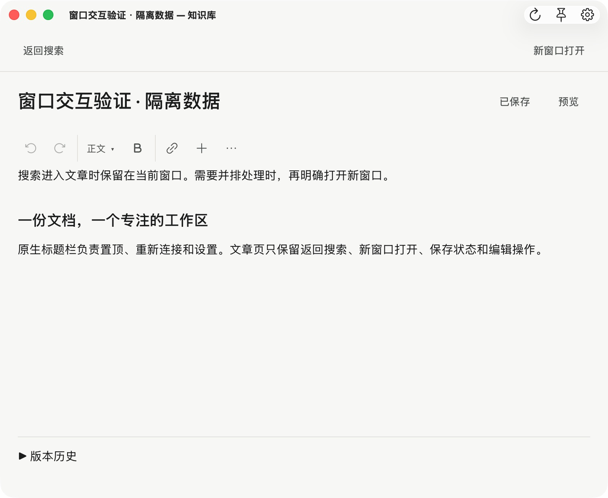

# 知识库窗口交互收敛

用户在安装使用后指出搜索、文章和设置窗口堆叠、界面重复。已明确确认：默认在当前窗口从搜索进入文章，仅“新窗口打开”另开；文章去掉首页导航。该决定替代初版插件中全部文章点击均发送 Native 新窗口消息的实现。

## 当前行为

- 启动器打开一个知识库任务后，列表/搜索/正文链接在该工作窗口内进入文章，返回保留关键词。
- 列表和文章中提供明确的新窗口操作。只有这些操作发送 Native `openDocument`；普通浏览器回退到新标签。
- 文章不渲染文章/收集箱/快速收集/新建/退出整套首页导航，仅保留返回搜索与新窗口打开。
- 删除原生第二层品牌/域名栏。重连、置顶、设置在标准 `NSToolbar`，窗口采用 unifiedCompact 标题栏，尺寸受屏幕可用空间约束。
- Web 通过 v1 可选 `appearance` 消息同步实际主题，原生窗口背景与标题栏跟随。WKWebView 自身单独跟随 NSApp 系统外观，避免原生窗口显式外观反过来锁住 Web 的“跟随系统”偏好。
- 保留文章、收集和待确认队列保护；正文已确认离开的导航不重复询问，搜索词与同文档块变化不被视为丢弃队列。

## 验证

- 主题消息 RED：合法事件无回调，iframe 场景无法得到主框架主题；补齐处理后真实 WKWebView 测试通过。
- Native 7 项集成测试通过：含实际 NSWindow 紧凑工具栏、置顶/恢复、页面与窗口主题独立、原有来源/iframe/导航/重试保护。
- Web 12 项定向单测与 16 条隔离 WebKit E2E 通过，涵盖同窗、显式新窗、返回关键词、草稿拒绝、只确认一次、队列及主题。
- Debug、Release、Web 构建通过；Web 完整 lint、format、deprecation、diff 检查通过。
- 独立只读代码复审未发现剩余 P1/P2，修复了审查指出的搜索词更改误触队列丢弃确认。

## 实际原生交互证据

用本次 Debug 构建建立独立测试副本（单独 bundle ID），连接仅 loopback 的代理与 Vite。全部 API 返回隔离内存数据；登录凭据为虚构 fixture，未连接生产认证或内容接口。

通过 macOS 原生 CUA 实际操作：登录 → 搜索列表 → 普通点击文章（窗口 AX 标识保持 0）→ 返回搜索（仍为同窗）→ 明确新窗口打开（新的 AX 标识43）→ 标题栏图钉切换后 Help 为“取消窗口置顶”→ Cmd-Q 正常完成多个已保存窗口的关闭握手。测试副本、Vite 和代理均已停止，日常安装版当时保持运行。

Web 的 900×640 明暗截图位于当前聊天 visualizations 的 `kb-window-refinement/compact-{search,editor}-{light,dark}.png`。物理中文输入法本轮未测试；没有用真实文章编辑或覆盖内容验证。

## 交付

Web 提交 `4075439f88946ee4a5e62ddf1f5406e5d568406f` 已推送；[Actions 39122487329](https://github.com/CrxusDonts/DontsKb/actions/runs/39122487329) 的 verify、deploy 均成功。生产 `deployed-commit` 与该 SHA 一致，API/Web/Caddy/Blog 四个容器 healthy，公网 live/ready 均返回 ok，公网 HTML 与运行中 Web 容器 HTML 的 SHA256 一致。

新版 Release 已安装到 `/Applications/DontsTool.app` 并正常重启，签名严格校验通过，安装文件与构建文件 SHA256 一致：`ff2e739a4011a6f4fbdd78e725071b18ce38fcb08feb844777970dc277e78052`。运行进程可执行路径也确认来自该安装目录。旧安装已留备份。

实际安装版保留原有登录，在生产搜索列表普通点击文章后窗口标识仍为 0，显示返回搜索、新窗口打开与原生置顶工具栏，没有整套首页导航。仅打开与查看文章，未编辑真实文章内容。

实际安装版的生产文章截图仅在本机保留，不随仓库提交。上图为隔离数据界面。

独立匿名生产桥接探针首次等待 ready 超时；同一构建重试成功，确认 protocol v1、dark 外观事件、匿名搜索 authenticated=false/items=0、prepareClose(lock=true) 和 resumeInteraction 握手。首次超时未复现，不能据此声称网络或无窗口 WK 加载始终稳定；实际安装版与本地集成测试均已完成上述验证。
